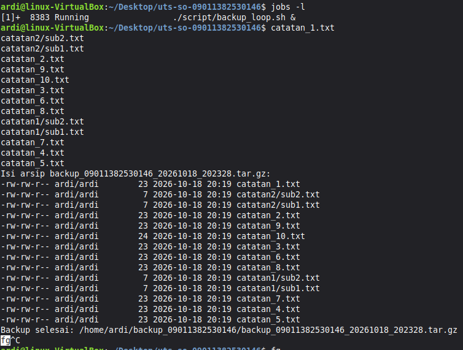

# UTS Sistem Operasi - Backup Otomatis dengan Shell Script

## Identitas
- **Nama** : Ardi Mustakim
- **NIM**  : 09011382530146
- **Kelas**: [SKU3B]

## Deskripsi
Repositori ini berisi kumpulan *shell script* yang secara otomatis mencari
seluruh file `.txt` di direktori sumber (`~/data_09011382530146`, termasuk
di dalam subdirektori) menggunakan `find`, mengarsipkan dan mengompresinya
menjadi satu file `.tar.gz` menggunakan `tar -czvf`, lalu mencatat setiap
proses backup ke file log (`~/backup_09011382530146/backup.log`).

- `script/backup.sh` menjalankan satu kali proses backup: mencari file,
  membuat arsip bernama `backup_09011382530146_TANGGAL_JAM.tar.gz`,
  menampilkan isi arsip dengan `tar -tzvf`, mencatat log, dan merapikan
  arsip lama (lihat Fitur Pengembangan).
- `script/backup_loop.sh` menjalankan `backup.sh` berulang-ulang setiap
  `INTERVAL` detik (bawaan 60 detik) menggunakan `while true` dan `sleep`,
  sehingga bisa dijalankan di *background* dan dikendalikan dengan
  *job control*.
- `script/alias.sh` berisi alias `bk146` agar `backup.sh` bisa dipanggil
  cukup dengan mengetik `bk146` dari mana saja.

## Cara Menjalankan

Pastikan repositori ini berada di `~/uts-so-09011382530146` dan direktori
sumber `~/data_09011382530146` sudah berisi data (minimal 10 file `.txt`,
2 file berekstensi lain, dan 2 subdirektori yang masing-masing berisi
minimal 2 file `.txt`).

```bash
cd ~/uts-so-09011382530146
chmod +x script/*.sh

# Backup sekali (mengarsipkan seluruh file .txt)
./script/backup.sh

# Backup ekstensi lain (fitur Parameter), misalnya file .pdf
./script/backup.sh pdf

# Backup berulang setiap 60 detik, dijalankan di background
./script/backup_loop.sh &

# Backup berulang dengan jeda kustom (30 detik)
./script/backup_loop.sh 30 &

# Mengaktifkan alias bk146
source script/alias.sh
bk146
```

Untuk mengaktifkan alias secara permanen, salin baris `alias` dari
`script/alias.sh` ke `~/.bashrc`, lalu jalankan `source ~/.bashrc`.

## Fitur Pengembangan

Dua fitur tambahan diimplementasikan di dalam `script/backup.sh`:

1. **Parameter** - Ekstensi file yang dicari dapat diberikan lewat
   argumen pertama. Tanpa argumen, script mencari `.txt` sesuai
   ketentuan wajib. Contoh mencoba: `./script/backup.sh pdf` akan
   mengarsipkan seluruh file `.pdf` di direktori sumber, bukan `.txt`.
2. **Rotasi arsip** - Hanya 5 arsip `.tar.gz` terbaru yang disimpan di
   `~/backup_09011382530146`; arsip yang lebih lama otomatis dihapus
   setiap kali backup baru selesai dibuat (nilai `MAX_ARSIP=5` di bagian
   atas `backup.sh`). File `backup.log` tidak ikut terhapus, sehingga
   riwayat seluruh proses backup tetap lengkap. Dicoba dengan menjalankan
   `backup.sh` lebih dari 5 kali berturut-turut dan memastikan hanya 5
   arsip terbaru yang tersisa di direktori backup.

## Bukti Job Control

<!--
ISI BAGIAN INI DENGAN HASIL ASLI DARI TERMINAL KAMU SENDIRI (bukan gambar).
Jalankan urutan perintah berikut di VM kamu, lalu salin-tempel keluaran
aslinya ke dalam blok kode di bawah ini:

cd ~/uts-so-09011382530146
./script/backup_loop.sh &
jobs -l
fg
# tekan Ctrl+Z di sini untuk menghentikan sementara (suspend)
bg
ps x
kill %1
jobs -l
-->

```
   
```

## Kendala

<!-- Tuliskan error yang pernah muncul selama mengerjakan dan bagaimana
cara kamu mengatasinya, misalnya masalah izin eksekusi, perbedaan akhir
baris (CRLF), jam VM yang tidak sinkron, dsb. -->

-
